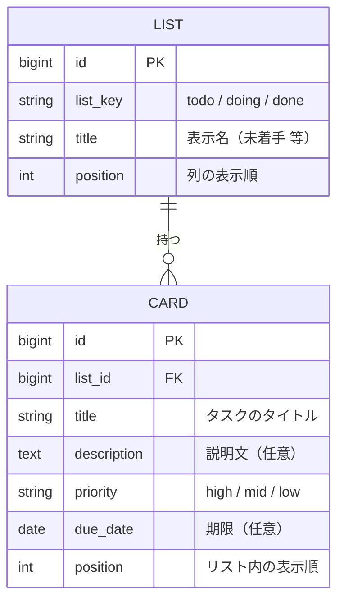

# データベース設計（テーブル定義・ER図）

[要件定義書](../要件定義書.md) の詳細資料です。

## 1. テーブル定義

PostgreSQL上に`lists`テーブルと`cards`テーブルを持つ。ボードは1つだけの想定のため、`board`テーブルは作らない（`lists`全体で1つのボードを表す）。

### lists（リスト：未着手・作業中・完了）

| カラム名 | 型 | 説明 |
|---|---|---|
| id | BIGSERIAL (PK) | リストの識別子（自動採番） |
| list_key | VARCHAR | 固定キー（`todo` / `doing` / `done`） |
| title | VARCHAR | 表示名（「未着手」等） |
| position | INTEGER | 列の表示順 |

### cards（カード：タスク）

| カラム名 | 型 | 説明 |
|---|---|---|
| id | BIGSERIAL (PK) | カードの識別子（自動採番） |
| list_id | BIGINT (FK → lists.id) | どのリストに属するか |
| title | VARCHAR | タスクのタイトル（必須） |
| description | TEXT | 説明文（任意、空文字可） |
| priority | VARCHAR | 優先度（`high` / `mid` / `low`） |
| due_date | DATE | 期限（任意、NULL可） |
| position | INTEGER | リスト内での表示順（ドラッグ&ドロップの並びに対応） |

- `position`列を使うことで、「配列の順番」をDBのテーブルでも表現する（SQLのテーブルには本来「並び順」という概念が無いため、明示的な列で管理する）
- カードを移動・並び替えたときは、関係するカードの`position`値を更新する

## 2. ER図

- 1つのリストは複数のカードを持つ（1対多）
- カードは必ずいずれか1つのリストに属する（`list_id`は必須の外部キー）

## 3. 技術的な補足

- ORMにはSpring Data JPA + Hibernateを使用し、上記テーブルに対応するJavaのEntityクラス（`List`, `Card`）を用意する
- アプリ起動時、`lists`テーブルが空であれば、未着手／作業中／完了の3行を初期データとして投入する
- マルチユーザー対応は行わないため、ユーザーを表すテーブルは作らない

## 4. 変更履歴

- 当初はDBを使わず、`localStorage`にJSON形式でデータを保存する構成だった（`board`配列の中に`list`配列、その中に`card`配列という入れ子構造）
- React + Spring Boot + PostgreSQL構成への移行に伴い、上記の`lists`/`cards`テーブル設計に変更した
