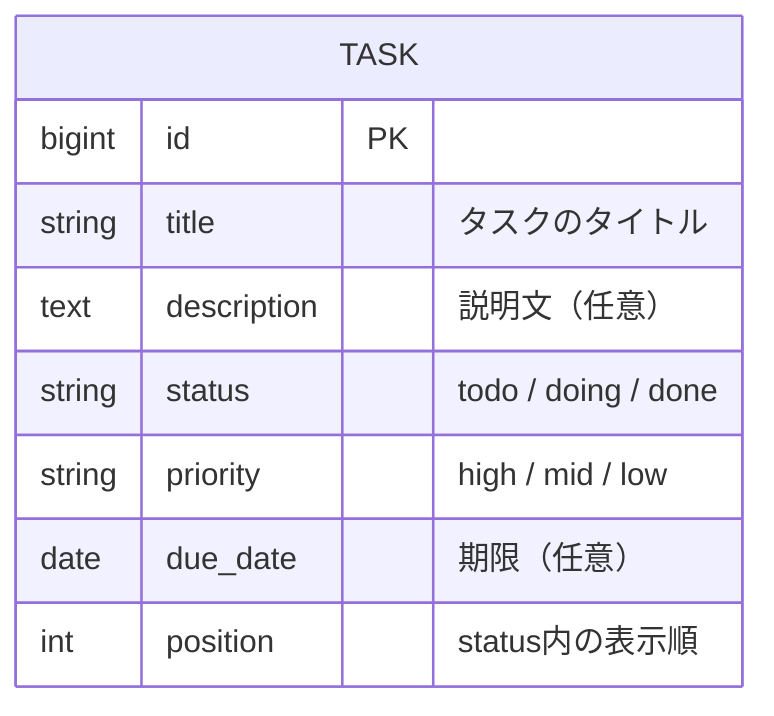

# データベース設計（テーブル定義・ER図）

[要件定義書](../要件定義書.md) の詳細資料です。

## 1. テーブル定義

PostgreSQL上に`tasks`テーブル1つだけを持つ。ボード・リストのテーブルは作らず、タスクがどの列（未着手／作業中／完了）に属するかは`status`列で表す。

### tasks（タスク）

| カラム名 | 型 | 説明 |
|---|---|---|
| id | BIGSERIAL (PK) | タスクの識別子（自動採番） |
| title | VARCHAR | タスクのタイトル（必須） |
| description | TEXT | 説明文（任意、空文字可） |
| status | VARCHAR | 所属する列（`todo`=未着手 / `doing`=作業中 / `done`=完了） |
| priority | VARCHAR | 優先度（`high` / `mid` / `low`） |
| due_date | DATE | 期限（任意、NULL可） |
| position | INTEGER | 同じstatus内での表示順（ドラッグ&ドロップの並びに対応） |

- 列の表示名（「未着手」等）はDBに持たず、フロントエンド側で`status`の値から決める
- `position`列を使うことで、「配列の順番」をDBのテーブルでも表現する（SQLのテーブルには本来「並び順」という概念が無いため、明示的な列で管理する）
- タスクを移動・並び替えたときは、`status`と、関係するタスクの`position`値を更新する

## 2. ER図

## 3. 技術的な補足

- ORMにはSpring Data JPA + Hibernateを使用し、上記テーブルに対応するJavaのEntityクラス（`Task`）を用意する
- 列が固定3つのため、初期データの投入は不要
- マルチユーザー対応は行わないため、ユーザーを表すテーブルは作らない

## 4. 変更履歴

- 当初はDBを使わず、`localStorage`にJSON形式でデータを保存する構成だった（`board`配列の中に`list`配列、その中に`card`配列という入れ子構造）
- React + Spring Boot + PostgreSQL構成への移行に伴い、`lists`/`cards`の2テーブル設計に変更した
- 列が固定3つで十分なため、`tasks`1テーブル（`status`列で列を表現）に簡素化した
